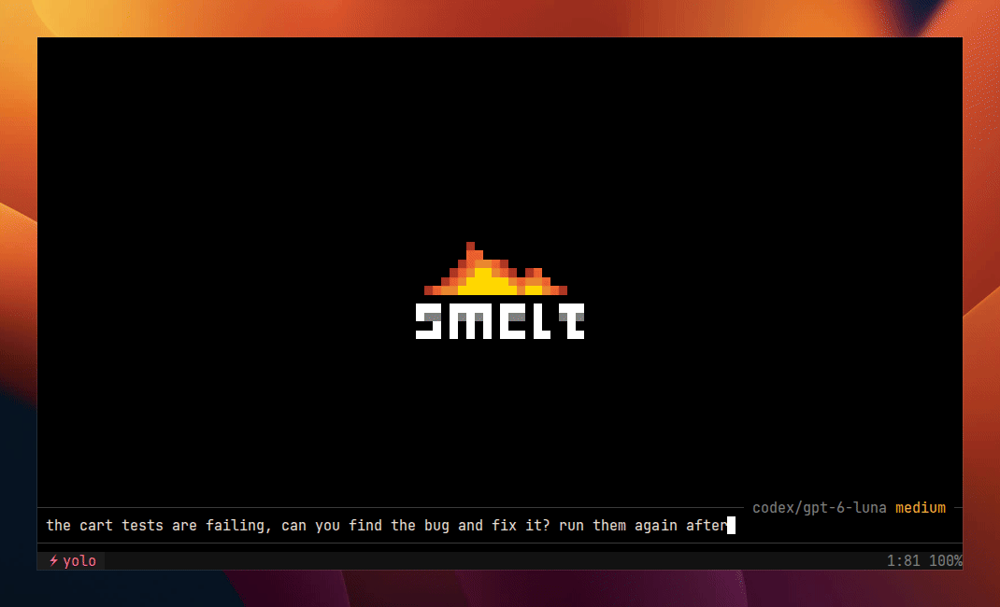

<p align="center">
  <picture>
    <source media="(prefers-color-scheme: dark)" srcset="docs/docs/logo-dark.svg">
    <source media="(prefers-color-scheme: light)" srcset="docs/docs/logo-light.svg">
    
  </picture>
</p>

<p align="center">
  <a href="https://smeltagent.dev/">Documentation</a>
  &nbsp;·&nbsp;
  <a href="https://smeltagent.dev/reference/api/">Lua API</a>
  &nbsp;·&nbsp;
  <a href="https://github.com/leonardcser/smelt/releases">Releases</a>
  &nbsp;·&nbsp;
  <a href="https://github.com/leonardcser/smelt/issues">Issues</a>
</p>

> [!WARNING]
> smelt is beta until 1.0. Interfaces may change between releases, so stay on
> the latest version.

## Why

Most coding agents are heavy and hard to change. smelt runs in a fraction of
their memory and CPU, and keymaps, commands, tools and the UI itself are plain
Lua files with no build step.

<p align="center">
  
</p>

## What's inside

- **Lua plugins.** Keymaps, commands, custom tools and modes, and the UI itself,
  from the statusline to the spinner. No build step.
- **Terminal renderer.** Its own grid and layout engine, not `ratatui`.
- **Vim editor.** Motions, text objects, registers, undo.
- **No config needed.** Run with flags, or use `smelt auth` for ChatGPT, GitHub
  Copilot, and Kimi Code.

## Benchmarks

Same model, same tasks: Terminal-Bench 2.1 with Qwen3.8 27B, 360 runs. Medians,
lower is better.

|                | Memory       | CPU time  | Wall time |
| -------------- | ------------ | --------- | --------- |
| **smelt**      | **0.20 GiB** | **6.1 s** | **352 s** |
| pi             | 0.71 GiB     | 9.7 s     | 399 s     |
| codex          | 2.09 GiB     | 9.8 s     | 372 s     |
| claude code    | 1.42 GiB     | 17.5 s    | 783 s     |
| opencode       | 2.80 GiB     | 116 s     | 421 s     |
| mini-swe-agent | 1.49 GiB     | 13.1 s    | 570 s     |

[Full results](https://smeltagent.dev/guide/benchmarks/)

## Install

```bash
curl -fsSL https://smeltagent.dev/install.sh | sh
```

Or grab a prebuilt binary (Linux and macOS on x86_64 and aarch64, Windows on
x86_64) from the [Releases](https://github.com/leonardcser/smelt/releases) page. Extract
the archive and put `smelt` (`smelt.exe` on Windows) on your `PATH`, or install
from source:

```bash
cargo install --locked --git https://github.com/leonardcser/smelt.git smelt-agent
```

## Run

**Subscription providers** (ChatGPT Pro/Plus, GitHub Copilot, Kimi Code):

```bash
smelt auth                          # one-time login
smelt                               # provider auto-detected from credentials
```

**Claude Code** (runs your installed Claude Code agent):

```bash
claude auth login                   # authenticate through Claude Code
smelt                               # claude-code models appear in the picker
```

Claude Code owns authentication, the agent loop, native tools, and context
management. smelt provides the terminal UI, permissions, and additional tools
through MCP. It does not copy subscription credentials or impersonate Claude
Code's API requests. See [the Claude Code backend guide](docs/docs/guide/claude-code.md)
for configuration, session behavior, and limitations.

**API-key providers** (any OpenAI-compatible endpoint):

```bash
# local model via Ollama
smelt --model qwen3.6:27b --api-base http://localhost:11434/v1

# OpenAI, Anthropic, OpenRouter, etc.
smelt --model gpt-5.5 --api-base https://api.openai.com/v1 --api-key-env OPENAI_API_KEY
```

Or just run `smelt` with no arguments and follow the wizard. The default mode
cycle is Normal → Plan → Apply → Yolo. Plan mode is bundled and autoloaded.
Optional bundled plugins include `which_key`, the local request inspector, and
LSP-backed semantic code tools; enable them from `~/.config/smelt/init.lua`.

## Docs

Full documentation for configuration, Lua API, keybindings, permissions,
providers, and plugin authoring lives at
**[smeltagent.dev](https://smeltagent.dev/)**.

## License

MIT, see [LICENSE](LICENSE). Inspired by
[Claude Code](https://github.com/anthropics/claude-code) and
[Neovim](https://github.com/neovim/neovim).
