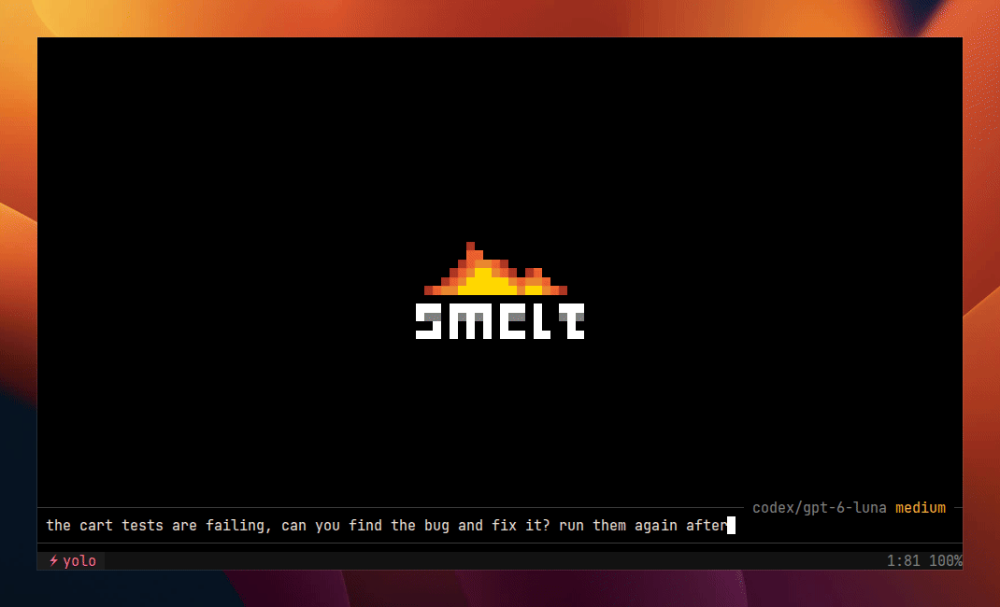

<p align="center">
  <picture>
    <source media="(prefers-color-scheme: dark)" srcset="docs/docs/logo-dark.svg">
    <source media="(prefers-color-scheme: light)" srcset="docs/docs/logo-light.svg">
    
  </picture>
</p>

<p align="center">
  <a href="https://smeltagent.dev/">Documentation</a>
  &nbsp;·&nbsp;
  <a href="https://smeltagent.dev/reference/api/">Lua API</a>
  &nbsp;·&nbsp;
  <a href="https://github.com/leonardcser/smelt/releases">Releases</a>
  &nbsp;·&nbsp;
  <a href="https://github.com/leonardcser/smelt/issues">Issues</a>
</p>

> [!WARNING]
> smelt is beta until 1.0. Interfaces may change between releases, so stay on
> the latest version.

## Why

Most coding agents are heavy and hard to change. smelt installs as one small
binary, uses less memory and CPU, and you reshape it with plain Lua files that
reload live.

<p align="center">
  
</p>

## What's inside

- **Lua plugins.** Edit a Lua file to change keymaps, commands, tools or the UI.
  Changes apply live, with no restart and no build.
- **Own terminal renderer.** Built from scratch for the terminal, so typing and
  scrolling stay instant even in sessions with tens of thousands of messages.
  [Why not `ratatui`?](https://smeltagent.dev/guide/design/#a-terminal-renderer-of-our-own)
- **Vim editor.** The same motions work in the prompt and the transcript, so you
  can search and yank agent output without the mouse.
- **No config needed.** Run with flags, or use `smelt auth` for ChatGPT, GitHub
  Copilot, and Kimi Code.

Why we made these choices, and what they cost:
[Design decisions](https://smeltagent.dev/guide/design/).

## Benchmarks

Lower is better. Median of 3 runs, measured on 2026-11-08.

| Agent       | Install size | Startup  | Memory at start | CPU on a task | Memory after 64 turns |
| ----------- | ------------ | -------- | --------------- | ------------- | --------------------- |
| smelt       | 47 MiB       | 36 ms    | 19 MiB          | 1.6 s         | **102 MiB**           |
| pi          | 384 MiB      | 288 ms   | 101 MiB         | **1.4 s**     | 211 MiB               |
| fx          | **12 MiB**   | **7 ms** | **6 MiB**       | 1.9 s         | 253 MiB               |
| codex       | 516 MiB      | 76 ms    | 127 MiB         | 2.6 s         | 329 MiB               |
| omp         | 271 MiB      | 822 ms   | 285 MiB         | 2.9 s         | 482 MiB               |
| claude code | 325 MiB      | 267 ms   | 174 MiB         | 3.5 s         | 497 MiB               |
| opencode    | 247 MiB      | 820 ms   | 430 MiB         | 3.9 s         | 717 MiB               |

[Method](https://smeltagent.dev/guide/benchmarks/)
· [Full results and code](https://leonardcser.github.io/harness-resource-bench)

## Install

```bash
curl -fsSL https://smeltagent.dev/install.sh | sh
```

Or grab a prebuilt binary (Linux and macOS on x86_64 and aarch64, Windows on
x86_64) from the [Releases](https://github.com/leonardcser/smelt/releases) page.
Extract the archive and put `smelt` (`smelt.exe` on Windows) on your `PATH`, or
install from source:

```bash
cargo install --locked --git https://github.com/leonardcser/smelt.git smelt-agent
```

## Run

**Subscription providers** (ChatGPT Pro/Plus, GitHub Copilot, Kimi Code):

```bash
smelt auth                          # one-time login
smelt                               # provider auto-detected from credentials
```

**Claude Code** (runs your installed Claude Code agent):

```bash
claude auth login                   # authenticate through Claude Code
smelt                               # claude-code models appear in the picker
```

Claude Code owns authentication, the agent loop, native tools, and context
management. smelt provides the terminal UI, permissions, and additional tools
through MCP. It does not copy subscription credentials or impersonate Claude
Code's API requests. See
[the Claude Code provider docs](https://smeltagent.dev/latest/customize/providers/#claude-code)
for configuration and limitations. smelt is not affiliated with Anthropic.

**API-key providers** (any OpenAI-compatible endpoint):

```bash
# local model via Ollama
smelt --model qwen3.6:27b --api-base http://localhost:11434/v1

# OpenAI, Anthropic, OpenRouter, etc.
smelt --model gpt-5.5 --api-base https://api.openai.com/v1 --api-key-env OPENAI_API_KEY
```

Or just run `smelt` with no arguments and follow the wizard. The default mode
cycle is Normal → Plan → Apply → Yolo. Plan mode is bundled and autoloaded.
Optional bundled plugins include `which_key`, the local request inspector, and
LSP-backed semantic code tools; enable them from `~/.config/smelt/init.lua`.

## Docs

Full documentation for configuration, Lua API, keybindings, permissions,
providers, and plugin authoring lives at
**[smeltagent.dev](https://smeltagent.dev/)**.

## License

MIT, see [LICENSE](LICENSE). Inspired by
[Claude Code](https://github.com/anthropics/claude-code) and
[Neovim](https://github.com/neovim/neovim).
